# Push'n'Pray

Our domain is serendipitous connections on campus. We designed two drawing tablets at campus waiting spots, a printer and a microwave, that give strangers a low-stakes way to connect by chance, in two modes:

- The message board (co-located, asynchronous) shows a location-based prompt, such as “What’s for lunch today?”, where students draw responses and see what others have left.
- Live drawing (distributed, synchronous) starts if both tablets are in use at the same moment, and the two students take turns drawing a scenario on a shared canvas until a timer runs out.

<table>
  <tr>
    <td align="center" width="50%">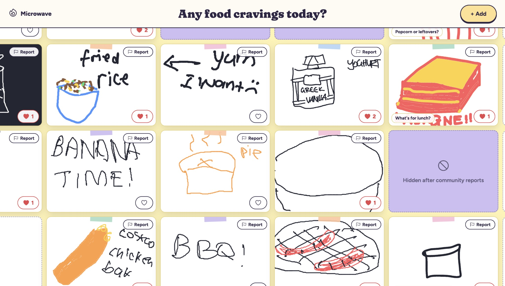 <b>Message board</b></td>
    <td align="center" width="50%">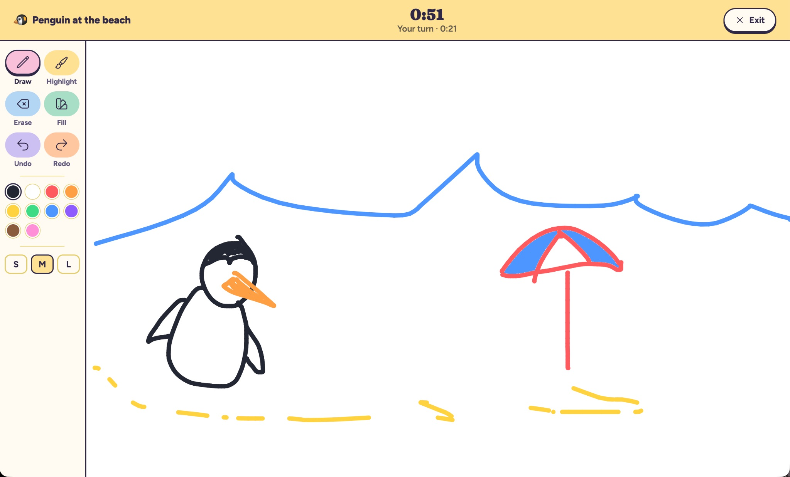 <b>Live drawing</b></td>
  </tr>
</table>

## Links

- **Poster:** [Figma](https://www.figma.com/design/TOC7FblF76KkeeZDGilEFy/DECO3500?node-id=165-26&t=34he9NMk0y4m5SNw-1) · [PDF in this repo](Design_Project_Sequence/Week%2012%20Tradeshow/L%5BINK%5D%20Poster.pdf)
- **Prototype:**
  - [Printer station](https://ellie-feng.github.io/pushnpray_DECO3500/Prototype/index.html?station=printer)
  - [Microwave station](https://ellie-feng.github.io/pushnpray_DECO3500/Prototype/index.html?station=microwave)
- **Design Process Overview:** [Design_Project_Sequence/Design Process Overview.docx](Design_Project_Sequence/Design%20Process%20Overview.docx) · [wiki page (PDF)](Wiki_Pages/Design%20Process%20Overview.pdf)
- **Ethical Considerations:** [Wiki_Pages/Ethical_Considerations.md](Wiki_Pages/Ethical_Considerations.md)
- **Google Drive** (identical to this repo): [folder](https://drive.google.com/drive/folders/15n4s01HUG-IWcYa6mOUB0FYncmP96WHY?usp=drive_link)

---

## Contents

1. [The idea](#the-idea)
2. [How it works](#how-it-works)
3. [Design process](#design-process)
4. [The prototype and running it](#the-prototype-and-running-it)
5. [Repository guide](#repository-guide)
6. [Ethics](#ethics)
7. [Team](#team)

---

## The idea

The two modes, placed on a time–space matrix:

|  | Synchronous | Asynchronous |
|---|---|---|
| **Co-located** | | **Message board** |
| **Distributed** | **Live drawing** | |

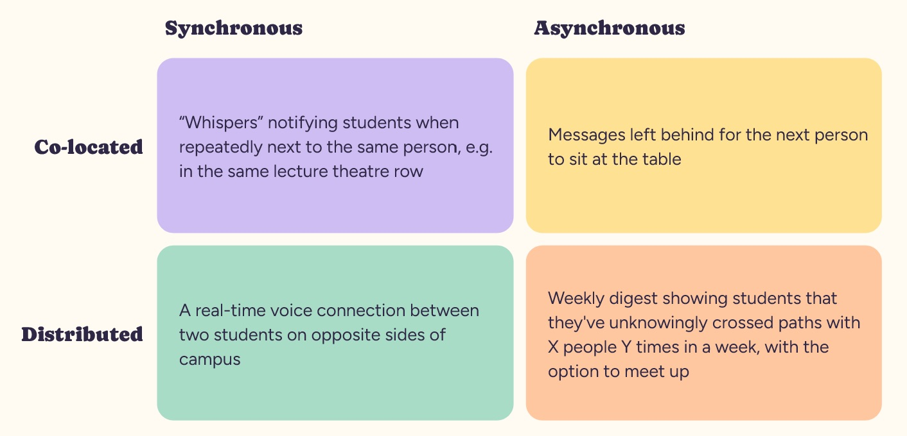 Our Week 5 time-space matrix.

---

## How it works

The minimum viable product (MVP) was built around three core features.

- When only a single tablet is active, users must be able to view and respond to a location-based prompt.
- When both tablets are active at the same time, users enter a shared collaborative drawing game.
- Once the game ends, users must be able to save their finished artwork.

<table>
  <tr>
    <td width="50%"></td>
    <td width="50%">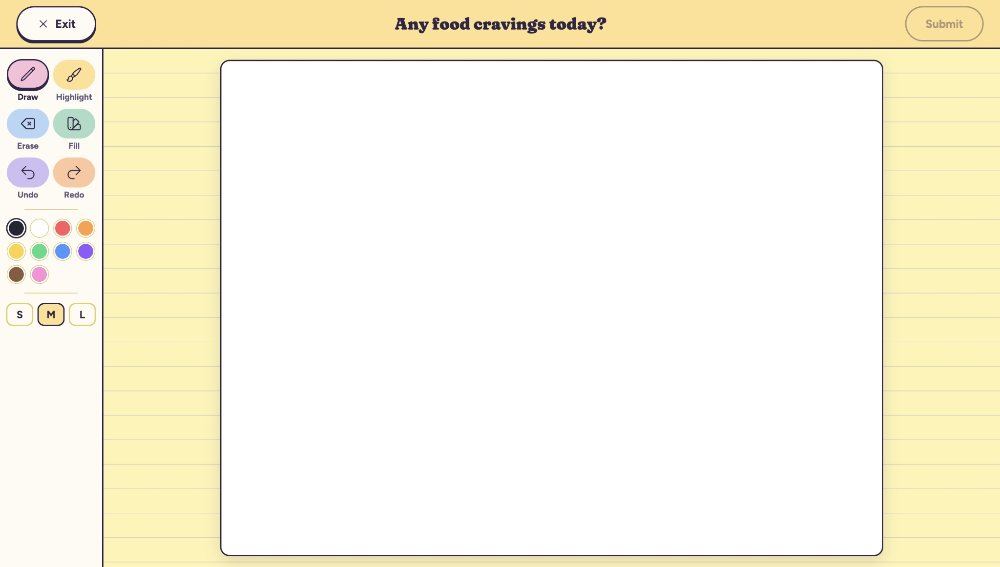</td>
  </tr>
  <tr>
    <td><b>Message board:</b> a location-based prompt, with the drawings others have left.</td>
    <td><b>Responding:</b> drawing a response to the prompt.</td>
  </tr>
  <tr>
    <td>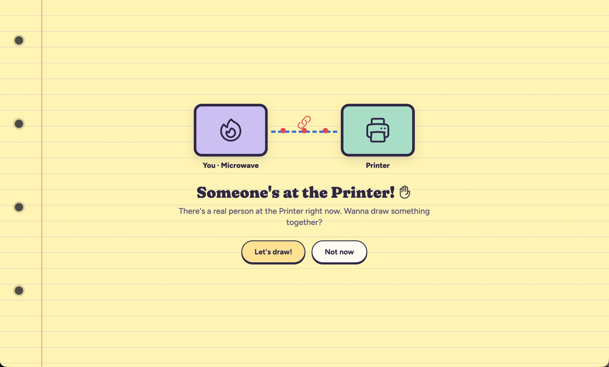</td>
    <td></td>
  </tr>
  <tr>
    <td><b>Both tablets active:</b> an invitation to draw together.</td>
    <td><b>Live drawing:</b> a shared canvas, drawing a scenario until the timer runs out.</td>
  </tr>
</table>

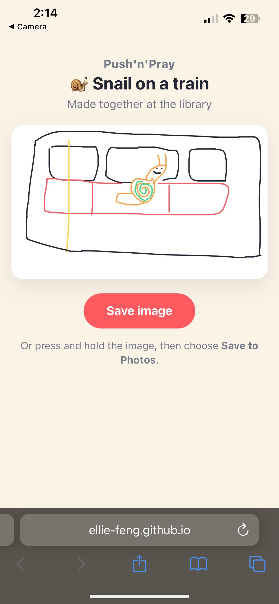 Saving the finished artwork (earlier prototype).

Using the 3C model, the message board supports communication, as strangers exchange drawings and messages over time. The turn-taking timer supports coordination, structuring who draws when. The shared canvas supports cooperation, as both people build one drawing together. Seeing the other person’s strokes appear live also gives each user awareness that someone real is on the other side.

---

## Design process

The full story is in the [Design Process Overview](Design_Project_Sequence/Design%20Process%20Overview.docx). Interview transcripts, testing transcripts and meeting minutes are all in the repo (see the [guide below](#repository-guide)).

### Domain Research

We started with low-stakes networking through shared interests. However, inspired by the Portal project, which links strangers in different cities through live video, we shifted towards unplanned, chance encounters. Research into prior attempts shaped this direction, where Sketching with Strangers showed strangers connecting through drawing alone and Next2You used a progressive reveal to build familiarity in low-stakes stages. Our Week 5 time-space matrix drew on these ideas, and the message trail and real-time connection shaped our final design.

### Preliminary Interviews

We interviewed six students about their experiences with strangers, avoiding design ideas so we could understand the problem first. Participants wanted connection but lacked a reason to start it: “There just aren’t enough excuses to actually talk to people.” Overall, it seemed that students were open to connecting with strangers but lacked a meaningful platform or way to do so.

### Probes

To see whether students would contribute to a message board, we left a broad “Leave a message for the next person!” sheet at the Dorothy Hill library printer from Friday to Monday, with three starter messages so it wouldn’t look empty. Students replied to these and to each other, including wishing a student “Happy Birthday”.

We then tested “Leave a secret!” by the library microwave and “Add to the drawing!” at Central library’s printer, each for two weeks. Secrets ranged from jokes to personal admissions, so anonymity let people share more than we expected, while the drawing sheet filled with playful images. Field observations at the microwave validated the natural waiting spot, as people noticed the sheet while waiting and rarely sought it out. It drew many responses within two days and no visible negative reactions. From these probes, it was clear students were interested in participating in a co-located message board activity, and actively engaged with one another asynchronously.

### Secondary Interviews

We interviewed nine students to test the concept and coded the findings using the COMB-B model. Participants said campus habits work against casual contact, where “Everyone’s always going somewhere…on their phone, or with headphones in”, and even curious participants would only engage with something they came across, not go out of their way for. We found that shared activities consistently reduced awkwardness through a participant mentioning it is “way less awkward than if we’d just been standing around trying to make small talk”. Because shared activities felt less awkward than conversation, we turned the proposal’s voice connection into drawing together, and kept the message trail as our message board.

<table>
  <tr>
    <td align="center" width="33%"> The Portal project</td>
    <td align="center" width="33%">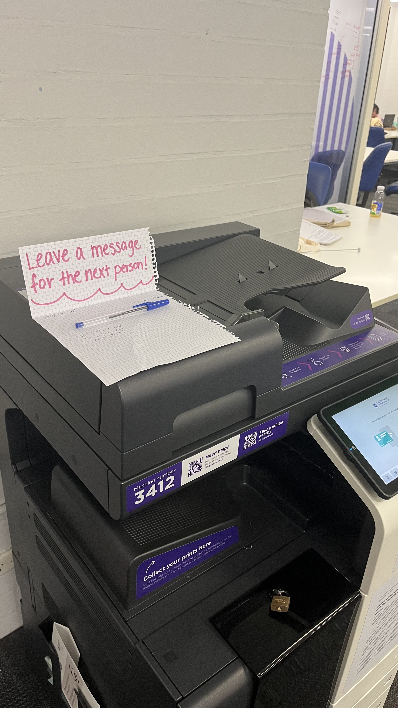 Probe: “Leave a message for the next person!”</td>
    <td align="center" width="33%">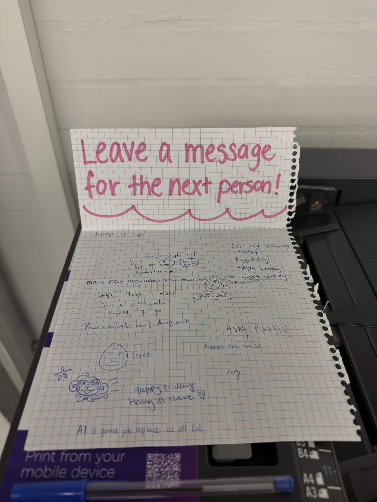 The same sheet, with replies</td>
  </tr>
  <tr>
    <td align="center">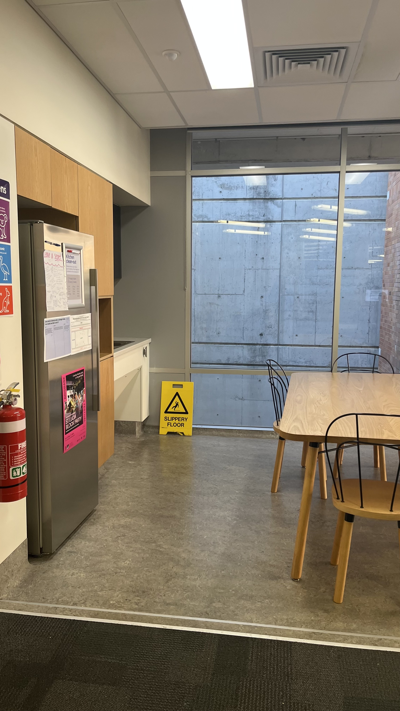 Probe: “Leave a secret!”</td>
    <td align="center">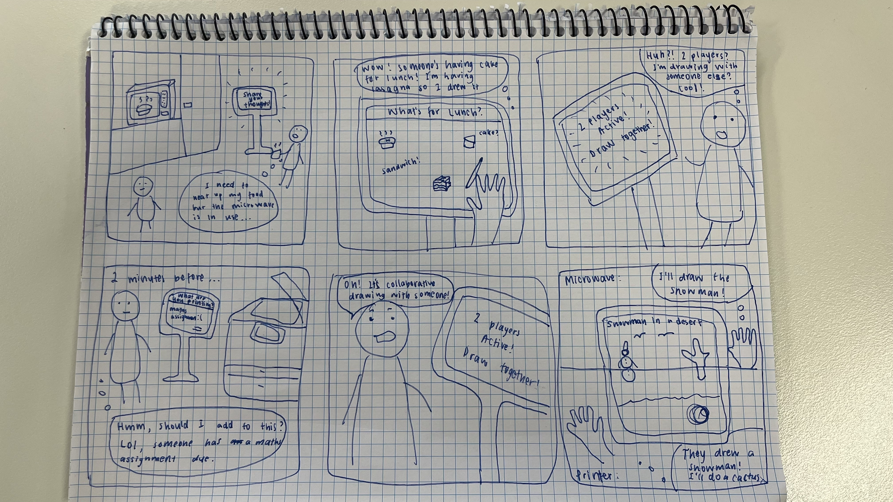 User journey sketch</td>
    <td align="center">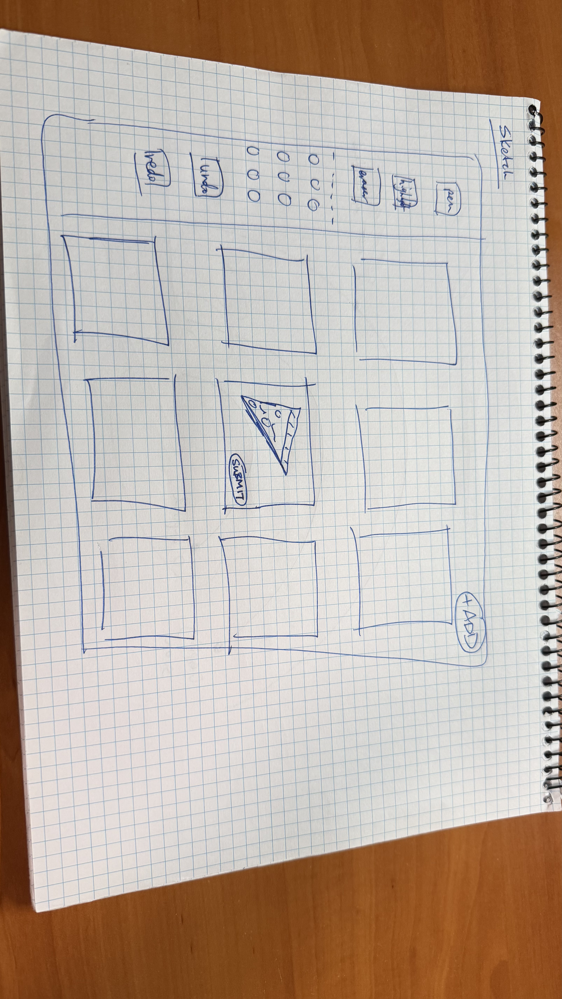 Wireframe (photographed sideways)</td>
  </tr>
</table>

### Prototype & Testing Sessions

We ran 9 testing sessions in 3 stages using different prototype versions. Two participants drew together in Apple’s Freeform app, knowing they were drawing with a stranger, before we built anything. Five sessions used a Wizard of Oz setup with our functioning prototype: a participant was told they were testing a message board while a teammate secretly used the second iPad and triggered live drawing, so the connection was a genuine surprise. Two final sessions took place in the real settings, a kitchen area and a printer, with each participant paired with another tester rather than a teammate.

#### What we found and what we changed

| What we found | What we changed |
|---|---|
| Freeform participant suggested alternating to facilitate cooperative and coordinate drawing | Turn-taking with a timer |
| Responses on the message board felt “very isolated… there’s a border around everything and it feels far apart” | One scrollable, zoomable grid, where tapping an empty square expands the canvas |
| Participants missed the back button and had no way to leave: “I would have loved to have a back button” | Exit buttons between every state |
| Participants skipped the instructions: “No one reads the instructions” | One short instruction card with images. |
| Observations noted that different prompts (“clock”, “owl”) made one shared picture hard | Both people get the same prompt, e.g. “a snail on a train” |
| Ethical concerns consider the implications of inappropriate content submitted. Probes also showed that content moderation needed to be implemented. | Added a community report button so users can flag inappropriate content |
| Transition into live drawing was a surprise, one participant thought the other person was prerecorded | Animation showing someone at the other tablet and a session about to begin |

#### Real-world testing

Real-world testing suggested the iterations worked. One participant stopped because of the colourful design and an already full board, the other while waiting for her food. Neither knew what it was straight away, but both worked it out from the existing drawings. Both found the move into live drawing clear, and she would use it again because she is “not doing anything while I’m waiting for my food”. Both wanted to know more about their partner, such as a short chat. However, with only two real-world sessions, so we cannot yet say how often live drawing would happen by chance. Next steps include a longer deployment, an opt-in short chat after each drawing and automated content screening.

<table>
  <tr>
    <td align="center" width="50%">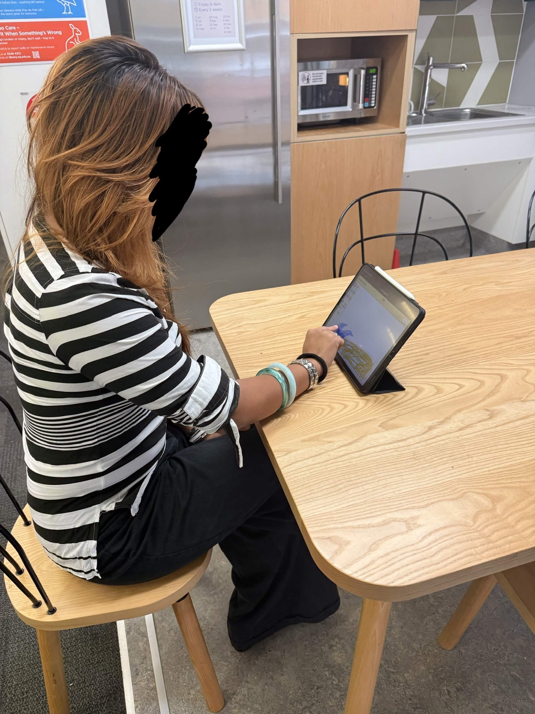 Real-world testing: kitchen area</td>
    <td align="center" width="50%">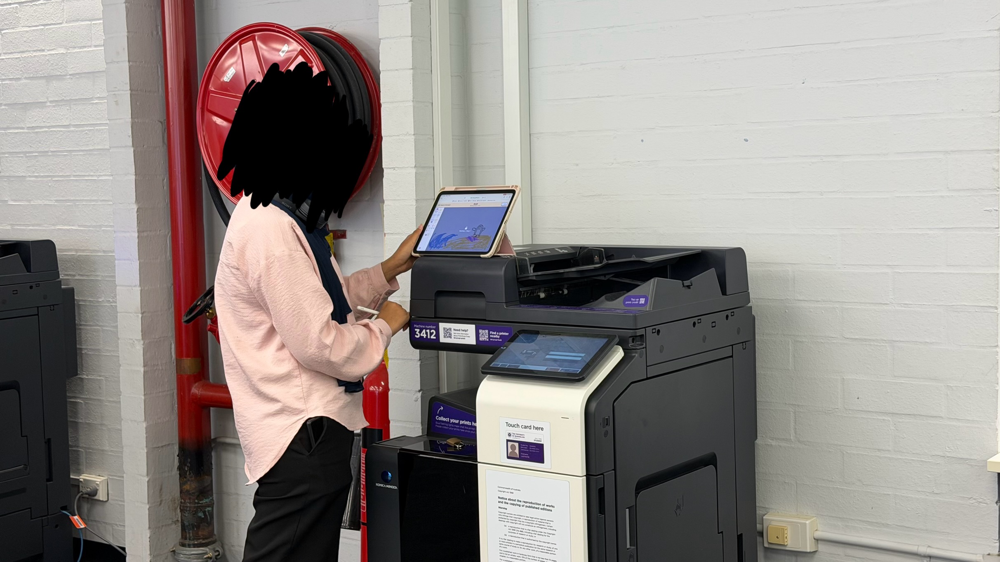 Real-world testing: printer</td>
  </tr>
</table>

<table>
  <tr>
    <td align="center" width="50%">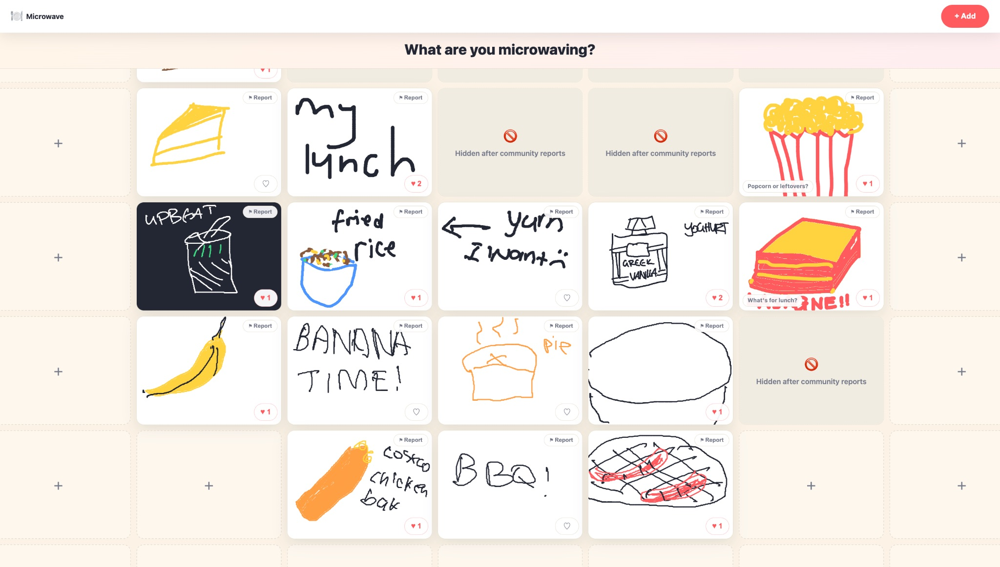 <b>Earlier prototype</b></td>
    <td align="center" width="50%"> <b>Final prototype</b></td>
  </tr>
</table>

---

## The prototype and running it

The prototype is a vanilla-JS, no-build static site (`Prototype/index.html` + `Prototype/src/`) deployed via GitHub Pages, with Firebase Realtime Database as the sync layer between the two tablets. Each tablet is set to its location with a URL parameter: `?station=printer` or `?station=microwave`.

To run your own copy:

1. Add your Firebase web app config to [`Prototype/src/firebase-config.js`](Prototype/src/firebase-config.js).
2. Enable Realtime Database on that Firebase project and publish the rules in [`Prototype/firebase/database.rules.json`](Prototype/firebase/database.rules.json).
3. Serve `Prototype/` as a static site (GitHub Pages: **Settings → Pages → Deploy from branch → `main`**), or locally with `python3 .claude/nocache-server.py 8777 Prototype` (a plain `python3 -m http.server` can serve stale scripts across reloads).
4. Open `index.html?station=printer` on one tablet and `index.html?station=microwave` on the other.

> `Prototype/PLAN.md` is the plan for the *first* version of the game and is kept for history; the design has since changed.

---

## Repository guide

Click through to any folder or document below. (`.docx` and `.pptx` files download rather than preview on GitHub.)

- **[Prototype/](Prototype)** — the working app
  - [index.html](Prototype/index.html) · [share.html](Prototype/share.html) · [styles.css](Prototype/styles.css)
  - [src/](Prototype/src) — [main.js](Prototype/src/main.js) · [game.js](Prototype/src/game.js) · [realtime.js](Prototype/src/realtime.js) · [canvas.js](Prototype/src/canvas.js) · [board.js](Prototype/src/board.js) · [floodfill.js](Prototype/src/floodfill.js) · [stations.js](Prototype/src/stations.js) · [prompts.js](Prototype/src/prompts.js) · [ui.js](Prototype/src/ui.js) · [icons.js](Prototype/src/icons.js) · [qr.js](Prototype/src/qr.js) · [share.js](Prototype/src/share.js) · [firebase-config.js](Prototype/src/firebase-config.js)
  - [firebase/database.rules.json](Prototype/firebase/database.rules.json) — Realtime Database security rules
  - [PLAN.md](Prototype/PLAN.md) — the original plan for the first version of the game (historical)
- **[Design_Proposal/](Design_Proposal)** — Weeks 1–5: the initial pitch
  - [Team Charter](Design_Proposal/DECO3500%20PNP%20Team%20Charter.docx) · [Week 3 Domain Research](Design_Proposal/Week%203%20Domain%20Research.docx) · [Design Proposal Script](Design_Proposal/Design%20Proposal%20Script.docx) · [Week 5 Presentation](Design_Proposal/Week%205%20Design%20Proposal%20Presentation.pptx) · [Proposal Slides](Design_Proposal/Push%20n%20Pray_%20Design%20Proposal%20Slides.pptx)
  - [Preliminary Interviews/](Design_Proposal/Preliminary%20Interviews) — [Protocol](Design_Proposal/Preliminary%20Interviews/Preliminary%20Interview%20Protocol.docx) · [COM-B coding scheme](Design_Proposal/Preliminary%20Interviews/Preliminary_COM-B_Coding_Scheme_Serendipitous_Connections.docx) · transcripts: [B1](Design_Proposal/Preliminary%20Interviews/Participant%20B1.docx) · [B2](Design_Proposal/Preliminary%20Interviews/Participant%20B2.docx) · [E1](Design_Proposal/Preliminary%20Interviews/Participant%20E1.docx) · [H1](Design_Proposal/Preliminary%20Interviews/Participant%20H1.docx) · [L1](Design_Proposal/Preliminary%20Interviews/Participant%20L1.docx) · [L2](Design_Proposal/Preliminary%20Interviews/Participant%20L2.docx)
- **[Design_Project_Sequence/](Design_Project_Sequence)** — the design process, in order
  - [Design Process Overview](Design_Project_Sequence/Design%20Process%20Overview.docx) — **start here:** the best single summary of the project
  - [Preliminary Stage and Journey/](Design_Project_Sequence/Preliminary%20Stage%20and%20Journey) — [Brainstorming](Design_Project_Sequence/Preliminary%20Stage%20and%20Journey/Brainstorming.docx) · [Idea](Design_Project_Sequence/Preliminary%20Stage%20and%20Journey/Idea.docx) · [Field Observations](Design_Project_Sequence/Preliminary%20Stage%20and%20Journey/Field%20Observations.docx) · [User Journey Sketch](Design_Project_Sequence/Preliminary%20Stage%20and%20Journey/User%20Journey%20Sketch.pdf) · [Early Demo (video link)](Design_Project_Sequence/Preliminary%20Stage%20and%20Journey/Early%20Demo.md)
  - [Secondary Interviews/](Design_Project_Sequence/Secondary%20Interviews) — [Protocol](Design_Project_Sequence/Secondary%20Interviews/Secondary%20Interview%20Protocol.docx) · [Main analysis](Design_Project_Sequence/Secondary%20Interviews/Secondary%20Interview%20Main%20Analysis.docx) · [COM-B coding](Design_Project_Sequence/Secondary%20Interviews/COM-B_Coding_Scheme_Secondary_Interviews.md.docx) · transcripts: [B1](Design_Project_Sequence/Secondary%20Interviews/Secondary%20Interview%20B1.docx) · [B2](Design_Project_Sequence/Secondary%20Interviews/Secondary%20Interview%20B2.docx) · [E1](Design_Project_Sequence/Secondary%20Interviews/Secondary%20Interview%20E1.docx) · [E2](Design_Project_Sequence/Secondary%20Interviews/Secondary%20Interview%20E2.docx) · [H1](Design_Project_Sequence/Secondary%20Interviews/Secondary%20Interview%20H1.docx) · [H2](Design_Project_Sequence/Secondary%20Interviews/Secondary%20Interview%20H2.docx) · [L1](Design_Project_Sequence/Secondary%20Interviews/Secondary%20Interview%20L1.docx) · [L2](Design_Project_Sequence/Secondary%20Interviews/Secondary%20Interview%20L2.docx) · [R1](Design_Project_Sequence/Secondary%20Interviews/Secondary%20Interview%20R1.docx) · [R2](Design_Project_Sequence/Secondary%20Interviews/Secondary%20Interview%20R2.docx)
  - [Testing Sessions/](Design_Project_Sequence/Testing%20Sessions)
    - [Testing Session Transcripts/](Design_Project_Sequence/Testing%20Sessions/Testing%20Session%20Transcripts) — [Freeform session (P2)](Design_Project_Sequence/Testing%20Sessions/Testing%20Session%20Transcripts/Freeform%20Testing%20Session%20%E2%80%94%20Participant%202.docx) · [Same shared prompt version (P1)](Design_Project_Sequence/Testing%20Sessions/Testing%20Session%20Transcripts/Functioning%20Prototype%20Testing%20Session%20%28Same%20Shared%20Prompt%20Version%29%20Participant%201.docx) · functioning prototype sessions [1](Design_Project_Sequence/Testing%20Sessions/Testing%20Session%20Transcripts/Functioning%20Prototype%20Testing%20Session%201.docx) · [2](Design_Project_Sequence/Testing%20Sessions/Testing%20Session%20Transcripts/Functioning%20Prototype%20Testing%20Session%202.docx) · [3](Design_Project_Sequence/Testing%20Sessions/Testing%20Session%20Transcripts/Functioning%20Prototype%20Testing%20Session%203.docx) · [4](Design_Project_Sequence/Testing%20Sessions/Testing%20Session%20Transcripts/Functioning%20Prototype%20Testing%20Session%204.docx)
    - [Real-World Testing/](Design_Project_Sequence/Testing%20Sessions/Real-World%20Testing) — [Participant 1](Design_Project_Sequence/Testing%20Sessions/Real-World%20Testing/Alya.docx) · [Participant 2](Design_Project_Sequence/Testing%20Sessions/Real-World%20Testing/Mahalia.docx)
    - [Testing Session 1 (recording)](Design_Project_Sequence/Testing%20Sessions/Testing%20Session%201.mp4) · [Functional Testing Session 5 (recording link)](Design_Project_Sequence/Testing%20Sessions/Functional%20Testing%20Session%205.md)
  - [Week 9 Stand Up/](Design_Project_Sequence/Week%209%20Stand%20Up) — [Meeting minutes](Design_Project_Sequence/Week%209%20Stand%20Up/Week%209%20Stand%20Up%20Meeting%20Minutes.docx) · [Testing evaluation (PDF)](Design_Project_Sequence/Week%209%20Stand%20Up/Week%209%20Stand%20Up%20Testing%20Evaluation.pdf) · [Experience requirements](Design_Project_Sequence/Week%209%20Stand%20Up/experience%20requirements.docx)
  - [Week 12 Tradeshow/](Design_Project_Sequence/Week%2012%20Tradeshow) — [Poster (PDF)](Design_Project_Sequence/Week%2012%20Tradeshow/L%5BINK%5D%20Poster.pdf) · [Tradeshow Pitch](Design_Project_Sequence/Week%2012%20Tradeshow/Tradeshow%20Pitch.docx)
  - [Tradeshow Pics/](Design_Project_Sequence/Tradeshow%20Pics) — photos from the tradeshow
- **[Meeting_Minutes/](Meeting_Minutes)** — weekly team meeting notes: [Week 3](Meeting_Minutes/Week%203_%2016_08%20Sunday.docx) · [Week 4](Meeting_Minutes/Week%204_%2020_08%20Thursday.docx) · [Week 5](Meeting_Minutes/Week%205_%2028_08%20Friday.docx) · [Week 6](Meeting_Minutes/Week%206_%2004_09%20Friday.docx) · [Week 7](Meeting_Minutes/Week%207%2012_9.docx) · [Week 8](Meeting_Minutes/Week%208.docx) · [Week 9 stand-up](Meeting_Minutes/Week%209%20Stand%20Up.docx) · [Week 10](Meeting_Minutes/Week%2010_%2011_10.docx) · [Week 11](Meeting_Minutes/Week%2011%2014_10.docx) · [Week 12](Meeting_Minutes/Week%2012.docx)
- **[Wiki_Pages/](Wiki_Pages)**
  - [Ethical_Considerations.md](Wiki_Pages/Ethical_Considerations.md) — the Ethics for Designers canvas (Gispen, 2017)
  - [Design Process Overview.pdf](Wiki_Pages/Design%20Process%20Overview.pdf) — the wiki page version of the Design Process Overview
- **[Images/](Images)** — screenshots, probes, wireframes and photos used in this README
- **[.claude/](.claude)** — local dev server helper ([nocache-server.py](.claude/nocache-server.py), [launch.json](.claude/launch.json))
- **[README.md](README.md)** — this file

Large screen recordings (the early demo and Functional Testing Session 5) are too big for GitHub and are linked from the `.md` files in `Design_Project_Sequence/` instead.

---

---

## Ethics

See [Wiki_Pages/Ethical_Considerations.md](Wiki_Pages/Ethical_Considerations.md).

---

## Team

| Team Member | Contributions |
|---|---|
| Ruby | Domain research, Preliminary and secondary interviews with 4 participants, Probe distribution & collection, Field observations, Facilitated 7 testing sessions, Testing session post-interview with 7 participants, analysis & evaluation, Google Doc documentation & organisation, Design Process Overview, Tradeshow Poster, Pitch Script |
| Ellie | Domain research, Preliminary and secondary interviews with 4 participants. Probe distribution & collection,Testing session post-interview with 7 participants, Real-World Testing with 1 Participant, Analysis & Evaluation, Facilitating testing sessions, Functional Prototype, Github Organisation and Documentation, Design Process Overview, Tradeshow Poster |
| Bianca | Domain research, preliminary and secondary interviews, interview transcript collation, analysis, and evaluation, Google Drive/GitHub documentation and organisation including planning and organising meeting minutes, Design Process Overview, pitch script, Tradeshow Poster |
| Emily | Ethical Considerations Wiki, Preliminary and secondary interviews with 4 participants, Facilitating 4 testing sessions, Poster Design, content and execution. Future design opportunities. |
| Reyana | Domain research, Preliminary and secondary interviews, Real-World Testing with 1 Participant, Analysis & Evaluation, Assisting Testing Sessions, Tradeshow Poster |
